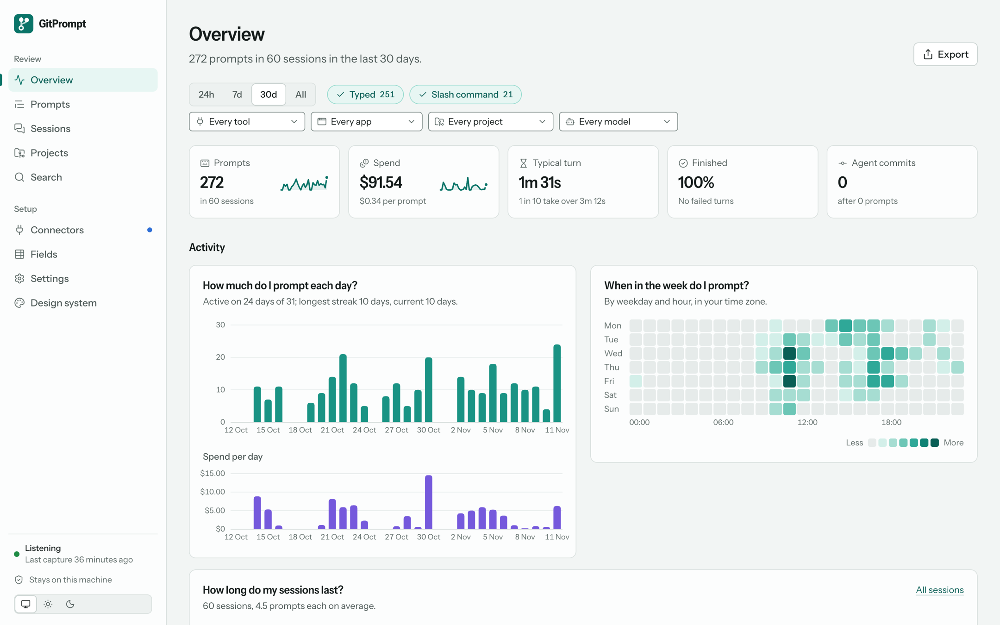
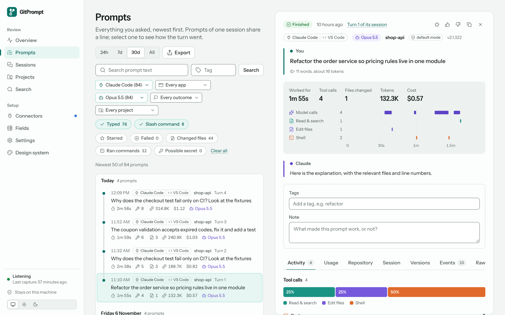
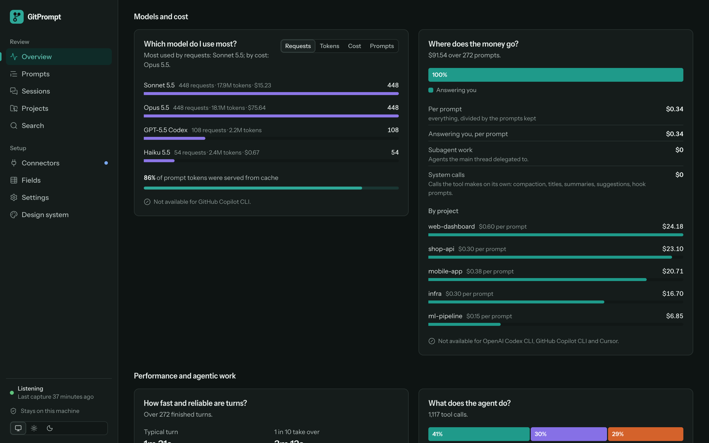
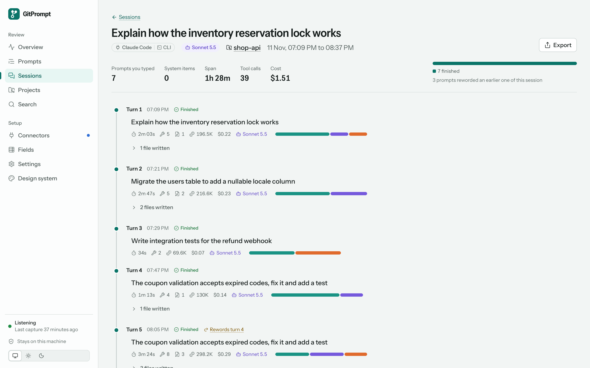
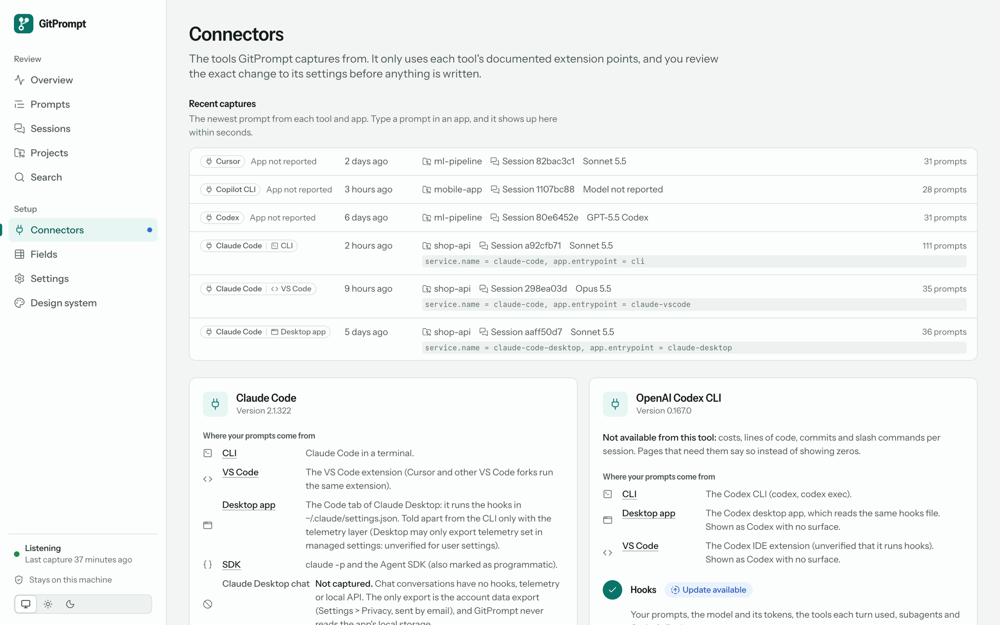
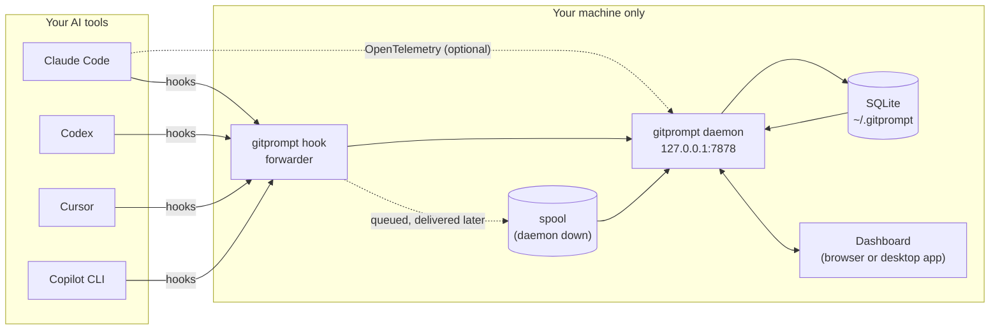

<div align="center">


# GitPrompt

**Keep every prompt you write to an AI coding tool, with its metadata, on your own machine.**

[](https://github.com/agharsallah/gitprompt/actions/workflows/ci.yml)
[](https://github.com/agharsallah/gitprompt/actions/workflows/audit.yml)


[Quick start](#quick-start) · [Features](#features) · [How it works](#how-it-works) · [Privacy](#privacy-and-the-tools-terms) · [Configuration](#configuration) · [Development](#development) · [Docs](#documentation)



</div>

## Why GitPrompt?

You type hundreds of prompts a week into Claude Code, Codex, Cursor and Copilot. They hold your decisions, your reasoning and what you learned, and they disappear into each tool's scrollback. GitPrompt keeps them, joined to what happened next:

- **One history for every tool.** Each prompt with its tool, app, model, project, branch and session.
- **The whole turn, not only the text.** Tool calls, files changed, commands run, tokens, cost, duration, outcome, and the commits that followed.
- **Insights you can act on.** When you prompt, which model costs what, which prompts you keep re-sending, where your agent spends its time.
- **Local and read-only.** A small daemon on `127.0.0.1` fed by each tool's documented hooks. Nothing leaves your machine, and nothing in your tools is blocked or changed.

## Supported tools

| Tool | Prompts and turns | Model | Tokens | Cost | Through |
|---|:-:|:-:|:-:|:-:|---|
| **Claude Code** (CLI, VS Code, Claude Desktop's Code tab, Agent SDK) | ✅ | ✅ | ✅ | ✅ | [Hooks](https://code.claude.com/docs/en/hooks) + optional [OpenTelemetry](https://code.claude.com/docs/en/monitoring-usage) |
| **OpenAI Codex** (CLI, desktop app, IDE extension) | ✅ | ✅ | ✅ (0.164+) | — | Hooks |
| **Cursor** (agent) | ✅ | ✅ | — | — | Hooks |
| **GitHub Copilot CLI** (and the Copilot agent in VS Code) | ✅ | — | — | — | Hooks |

When a tool doesn't report something, pages say so ("not available for GitHub Copilot CLI") instead of showing zeros. Claude Desktop's *chat* isn't captured: it has no hook, telemetry or local API. Details per tool and app: [docs/connectors.md](docs/connectors.md).

## Quick start

**Requirements:** Rust (the toolchain is pinned in [`rust-toolchain.toml`](rust-toolchain.toml)), Node with [pnpm](https://pnpm.io), and [just](https://just.systems).

```bash
git clone https://github.com/agharsallah/gitprompt.git
cd gitprompt
just setup     # install web dependencies, fetch Rust crates
just serve     # build the dashboard + release binary, run on http://127.0.0.1:7878
```

To run it from anywhere instead, `just install` puts a `gitprompt` binary (dashboard embedded) in `~/.cargo/bin`; then run `gitprompt serve`. Prefer a window and a tray icon? See the [desktop app](#desktop-app).

Then connect your first tool:

1. Open <http://127.0.0.1:7878> and click **Connect** on the Overview.
2. The **Connectors** page shows the exact change to your tool's settings (for Claude Code, `~/.claude/settings.json`). Confirm it; a backup goes to `~/.gitprompt/backups/`.
3. Optional: add Claude Code's **Telemetry** layer for model, tokens and cost (applies to sessions started afterwards).
4. Type a prompt in your tool. It appears live under **Prompts**.

Run `gitprompt check` at any time to see, per tool and app, the newest prompt that arrived.

## Features

### Every prompt, and how the turn went



**Prompts** lists everything you asked, newest first, grouped by session. Filter by tool, app, model, outcome (finished, failed, interrupted…), project and tag. Select a prompt to read the turn as a story: what you asked, a timeline of model and tool calls, the answer, then tabs for activity (tools, files, commands), usage (tokens, cache, models), the repository (state at send time, commits afterwards), the session and every raw event. Star, rate, tag and annotate prompts there.

Prompts you didn't type (task notifications, agent messages, subagent and programmatic runs) are muted and labelled with their origin. Context the tool added (an IDE selection, a system reminder) folds into a note under what you typed.

### Insights over all your prompts



The **Overview** is a dashboard of panels, each answering one question:

| Area | Questions it answers |
|---|---|
| Activity | How much and when do I prompt (per day, weekday × hour, streaks)? How long do my sessions last? |
| Prompt types | Who wrote these prompts? Which slash commands do I run? How long are my prompts, what do they reference, and which do I send again? |
| Models and cost | Which model do I use most, by requests, tokens or cost? Where does the money go (answering you, subagents, system calls; per prompt, per project)? |
| Performance and agentic work | How fast and reliable are turns? What does the agent do (tool kinds, subagents, MCP servers, denials) and what came of it (outcomes, commits, lines of code)? |

Filter by time range, origin, tool, app, project and model; every filter lives in the URL. Every bar, cell and row opens the matching prompts.

### Sessions and projects as stories



- **Sessions** reads a conversation as chapters: each prompt you typed with its outcome, tools, files, commits and cost, with task notifications, agent messages, subagent briefs and compactions folded into markers between them.
- **Projects** splits a repository's history into phases (a new phase after a pause of 3 hours or more, or a lasting move to another branch), each with its commits, cost and outcome mix.
- **Versions** (a tab on each prompt) lists its retries and the same instruction reused elsewhere, with the wording change marked word by word and whether the outcome improved.

### Search and export

- **Search** finds prompts by the words you typed (every word must appear, short words too), filtered by project, time range, origin and tag, with highlighted snippets.
- **Export** saves what you see (a session, a project, the Overview, a prompt list) as Markdown, a self-contained offline HTML report, CSV, JSON, or a single chart as SVG or PNG. By default an export holds figures only: no prompt text, relative paths, no account email or ids, and secrets always hidden. Nothing is uploaded ([ADR-0018](docs/adr/0018-export.md)).

### Connectors you can review before anything is written



Each tool is one card with its layers (for Claude Code: Hooks and Telemetry). Every layer shows one clear state (*Ready to connect*, *Receiving*, *Update available*, *Blocked by policy*…) with the one action it needs, a heartbeat, and exactly which events it stores, drops and never subscribes to. Connecting always shows the diff first; **Disconnect** removes only what GitPrompt added. Full reference: [docs/connectors.md](docs/connectors.md).

### Also

- **Fields** lists every captured field next to what the tool documents. **Design system** shows the tokens and components the dashboard is built from.
- Light and dark themes, keyboard navigation, and states that never rely on colour alone.

## How it works



1. **Capture.** Each tool runs a small `gitprompt hook` command on documented events (prompt submitted, tool used, turn ended). It forwards the payload to the local daemon and always exits 0, so a tool never sees a failing hook. If the daemon isn't running, the payload is spooled and delivered later with its original time.
2. **Map.** A declarative YAML spec per tool ([`backend/crates/gitprompt-core/specs/`](backend/crates/gitprompt-core/specs/)) maps that tool's payloads to one shape: prompt, session, project, model, tool calls, usage. New tools are mostly a new spec plus conformance fixtures ([ADR-0008](docs/adr/0008-universal-capture-declarative-sources.md)).
3. **Store and derive.** Raw events go to SQLite. Origin, outcome, cost, stories and statistics are derived on read and cached in a rebuildable prompt index with full-text search ([ADR-0012](docs/adr/0012-prompt-index-and-stats.md)).
4. **Show.** The daemon serves the SvelteKit dashboard (embedded in the binary) with live updates.

The daemon is written in Rust ([`backend/`](backend/README.md), [ADR-0023](docs/adr/0023-rust-backend.md)) and runs as the `gitprompt` command or inside the desktop app. The original Python daemon is deprecated and kept in [`legacy/python/`](legacy/python/README.md) for comparisons only. Design and roadmap: [PLAN.md](PLAN.md); architecture: [docs/architecture.md](docs/architecture.md).

## Privacy and the tools' terms

GitPrompt uses only each tool's documented extension points, in your user settings and pointed at this machine:

- It subscribes only to events that report what happened, never to decision points, and answers each hook with an empty response, so **nothing is blocked or changed**.
- It **never** reads credentials, intercepts traffic, reads a tool's private files, or sends anything off your machine.
- If your organization turns hooks off, or already exports telemetry, GitPrompt shows that and doesn't override it.
- Detected secrets can be hidden on arrival (Settings › Privacy), and are always hidden in exports.

Full rules: [PLAN.md §4](PLAN.md#4-terms-of-service-and-policy-guardrails).

## Desktop app

[`backend/apps/desktop`](backend/apps/desktop) is a Tauri v2 app that runs the same daemon in-process. Its window shows the dashboard; closing it keeps capturing (it hides to the tray: **Open GitPrompt**, **Start at login**, **Quit**), and only one copy runs. If a `gitprompt serve` is already running for the same data folder, the app uses it. Prompts sent while the app is closed are queued and ingested, with their original time, when it starts.

```bash
just desktop-dev      # run it from source
just desktop-build    # installers in backend/target/release/bundle (needs: cargo install tauri-cli --version "^2")
```

Browser and app show the same data: they talk to the same daemon on `127.0.0.1:7878` and its one database, with live updates in both.

## Configuration

**Settings** (`/settings`) groups everything you can configure: General (theme, default time range, week start), Connectors, Capture (event retention), Privacy, Data (database size and location, compact, delete events, backups) and Security (rotate the receiver token, then reconnect each connected tool after reviewing its diff).

Preferences live in `~/.gitprompt/preferences.json` (written atomically, mode 0600). Each value comes from, in order: an environment variable, the file, the default. The page shows where each value comes from; one set by an environment variable is read-only there. All apply without a restart.

| Key in `preferences.json` | Environment variable | Default | Effect |
|---|---|---|---|
| `default_range` (`24h`, `7d`, `30d`, `all`) | `GITPROMPT_DEFAULT_RANGE` | `7d` | Window Overview, Sessions and Projects open with |
| `week_start` (`monday`, `sunday`) | `GITPROMPT_WEEK_START` | `monday` | First row of the weekday heatmap |
| `event_retention_days` (1–3650 or `null`) | `GITPROMPT_EVENT_RETENTION_DAYS` | `null` (keep) | Raw events older than this are deleted at start-up and every 6 hours |
| `hide_secrets_on_ingest` | `GITPROMPT_HIDE_SECRETS_ON_INGEST` | `false` | Replace detected secrets before a payload is stored |

Environment-only: `GITPROMPT_HOME` (data folder, default `~/.gitprompt`), `GITPROMPT_PORT` (default `7878`), `GITPROMPT_LOG_LEVEL`, `GITPROMPT_LOG_FORMAT` and `GITPROMPT_DASHBOARD` ([ADR-0013](docs/adr/0013-preferences.md)). The theme stays in the browser.

## Command line

| Command | What it does |
|---|---|
| `gitprompt serve` | Run the receiver and dashboard (the default command; `--port N` overrides the port) |
| `gitprompt check` | Per connector and app: the newest captured prompt and how it was attributed |
| `gitprompt doctor` | Paths, daemon and lock, database and index, each connector, spool, preferences; then a one-line fix per problem. Changes nothing |
| `gitprompt compact` | Remove stored events the specs no longer keep, then `VACUUM` (dry run unless `--apply`) |
| `gitprompt reindex` | Rebuild the prompt index (filters, search, statistics), e.g. after restoring a backup |
| `gitprompt spool` | Inspect the queue of hook payloads not yet delivered |
| `gitprompt hook` | The forwarder your tools call; you never run it yourself |

### Keeping the database small

Telemetry start-up events (`hook_registered`, `plugin_loaded`, `hook_execution_*`, …) are not stored: the spec lists them under `drop_events`, and the Fields page shows them as not stored. To remove those stored by an older version, and optionally old raw events:

```bash
gitprompt compact                          # dry run: rows and MB per event, nothing changes
gitprompt compact --apply                  # delete them, then VACUUM
gitprompt compact --events-older-than 30   # also raw events older than 30 days
```

Prompts and your notes are never removed. Expired events take their turn details with them (tools, usage, timeline) for prompts older than the cutoff. Compact can run while the daemon is running. The same clean-up, a persistent retention and deleting events by source or date are on the **Settings** page, each with a dry run first.

### The prompt index

Filters, search and statistics run in SQL on a prompt index: one row per prompt with its derived values (origin, typed text, local day and hour, usage per model, tools, outcome) plus a full-text index of the typed text. It updates itself as events arrive and rebuilds itself when the rules or the code that compute it change; a running daemon reads its code once, so restart it after an update. Day and hour buckets use this machine's timezone; changing the timezone rebuilds the index on next use.

## Development

```bash
just            # list every task
just dev        # Rust daemon (restarts on change with cargo-watch) + Vite with hot reload on :5173
just verify     # what CI runs: fmt, clippy, cargo-deny, every Rust test (unit, integration, end-to-end), web checks and build
just doctor     # debug an install: one line per problem, with its fix
just bench      # ingest throughput and dashboard read latencies on synthetic data
just cov        # Rust line coverage report
```

`GITPROMPT_LOG_LEVEL=debug gitprompt serve` logs each request with its status and duration (slow ones are warnings at the default level). More in [docs/extending.md](docs/extending.md#debugging).

**Demo data.** To try the dashboard, or to refresh the screenshots in this README, without touching your own prompts:

```bash
python3 tools/seed-demo.py /tmp/gitprompt-demo
GITPROMPT_HOME=/tmp/gitprompt-demo GITPROMPT_PORT=7979 backend/target/release/gitprompt serve
```

It writes about 270 made-up prompts from all four tools over the last four weeks into a separate data folder.

### Repository layout

```
backend/                      Rust workspace (backend/README.md)
  crates/gitprompt-core       settings, preferences, errors, git facts, secrets, connector specs (specs/*.yaml)
  crates/gitprompt-store      SQLite store, the rebuildable prompt index (FTS5), statistics, housekeeping
  crates/gitprompt-capture    ingest pipeline (hooks, OTLP), probing and policy, connect/disconnect, spool, forwarder
  crates/gitprompt-insights   values derived on read: origin, surface, turns, sessions, lineage, stories, field catalog
  crates/gitprompt-export     exports: one redaction pass, report builders, one renderer per format
  crates/gitprompt-server     the Service (one method per use case), axum routes, live-update bus, the daemon
  crates/gitprompt-dashboard  the built dashboard, embedded
  crates/gitprompt-cli        the `gitprompt` binary
  crates/gitprompt-tauri      Tauri plugin: the daemon in-process, native commands
  apps/desktop                the desktop app
  testdata/fixtures/<tool>/   conformance fixtures, shared by the crates' tests
web/src/lib/                  SvelteKit dashboard (built into web/build)
  design/                     design tokens and base styles
  ui/                         generic components; ui/charts/ for charts
  insights/                   stories computed from prompts (sessions, projects, timelines)
  settings/                   Settings page sections, preference cache
docs/                         architecture, connectors, extending, source research, ADRs, images
tools/                        demo data seeder; legacy Python vs Rust comparison
legacy/python/                the deprecated FastAPI daemon (frozen)
```

## Documentation

| Document | Read it for |
|---|---|
| [PLAN.md](PLAN.md) | Goals, design, guardrails and roadmap |
| [docs/architecture.md](docs/architecture.md) | Process model, domain model, storage, ingestion |
| [docs/connectors.md](docs/connectors.md) | Connector states, apps per tool, writing or patching a connector spec |
| [docs/extending.md](docs/extending.md) | Where each kind of change goes, and debugging |
| [docs/sources.md](docs/sources.md) | What each tool documents, checked against vendor docs |
| [docs/adr/](docs/adr/README.md) | Architecture decision records |
| [backend/README.md](backend/README.md) | The Rust workspace |

## Contributing

Issues and pull requests are welcome. Before opening a PR, run `just verify`, which runs the same checks as CI. To add or fix support for a tool, start with [docs/connectors.md](docs/connectors.md#adding-or-fixing-a-connector); for anything else, [docs/extending.md](docs/extending.md) says where the change goes. Significant design changes get an [ADR](docs/adr/README.md).

## License

MIT, as declared in [`backend/Cargo.toml`](backend/Cargo.toml).
